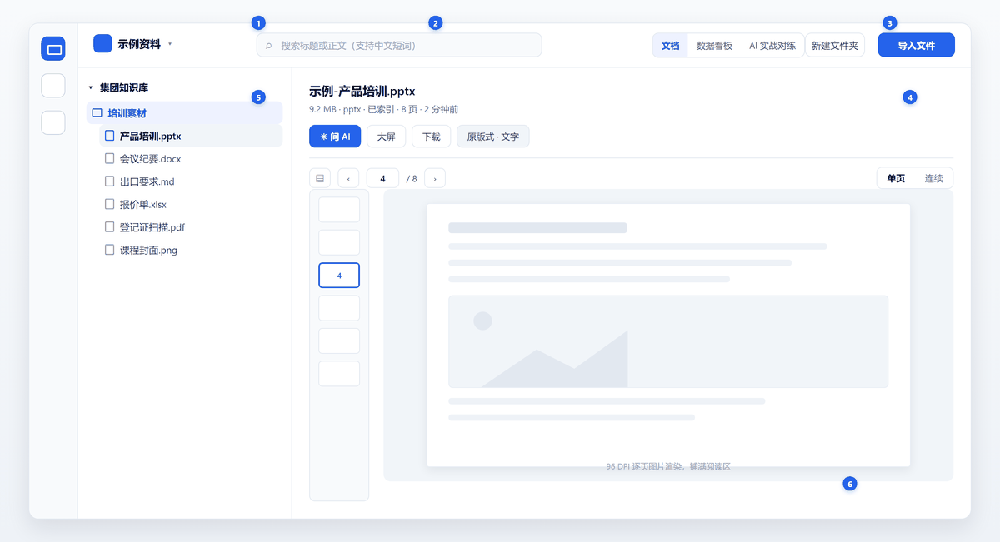
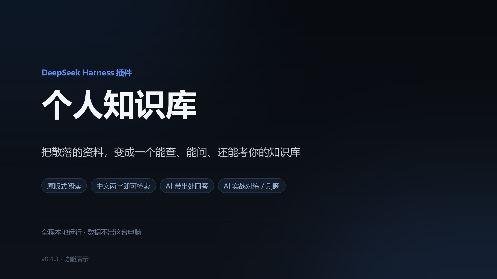
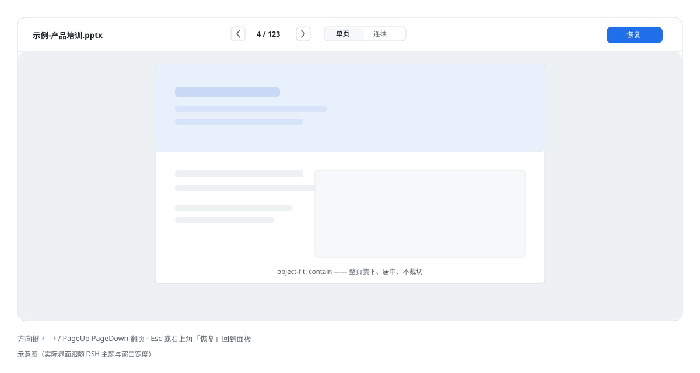
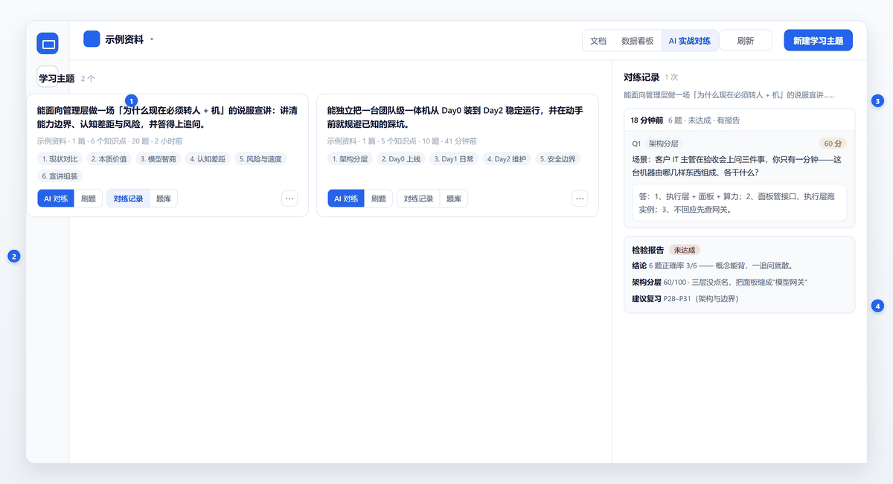
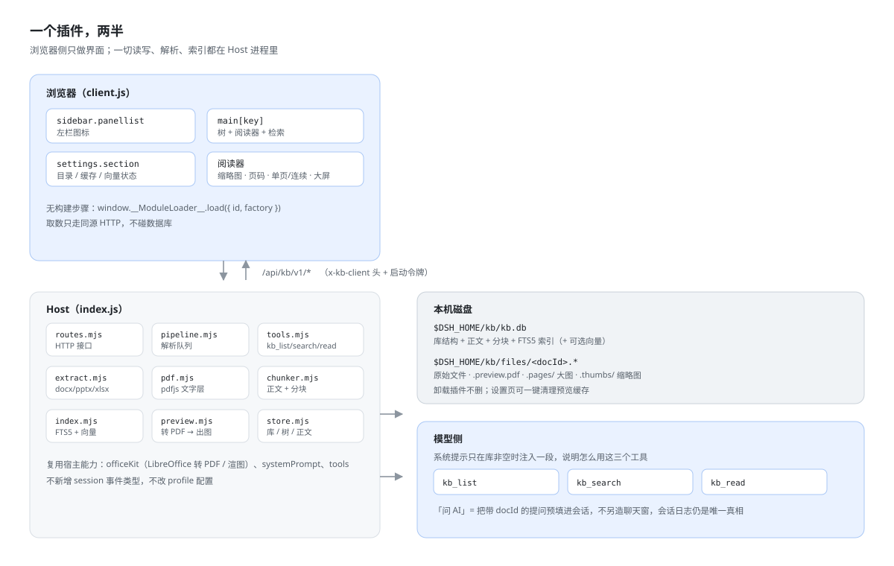

# DSH 个人知识库插件

[](https://www.npmjs.com/package/@xiaofanzhao/dsh-plugin-knowledge-base)
[](LICENSE)
[](https://nodejs.org/)

把散落在本机的 PPT、Word、Excel、PDF、图片整理成**树状知识库**：点开就是原始版式，搜中文两字词也能命中，AI 能检索、带着出处回答，还能基于它出题陪练。

- 📂 **原版式查看** —— Office / PDF 转页渲染，缩略图漫游、页码跳转、大屏放映
- 🔍 **中文全文检索** —— SQLite FTS5 + CJK 归一化，短词也能中；可选向量检索
- 🤖 **AI 会用你的资料** —— 三个只读工具，任何会话里都能检索、读正文、标出处
- 🎯 **学与练** —— 建学习主题后「AI 对练」或「刷题」，记录、评分、检验报告都能回看
- 🔒 **纯本地** —— 文件与索引都在 `~/.dsh/kb`，不上传云端



<sub>示例界面：文件名为占位示例；真实界面跟随 DSH 主题与窗口宽度。</sub>

### 演示视频

[](docs/media/demo-1080p.mp4)

▶ **[看演示视频（1 分 41 秒，1080p）](docs/media/demo-1080p.mp4)** · [竖版 9:16](docs/media/demo-vertical-1080x1920.mp4)（视频号/抖音用）

<sub>15 个片段：知识库面板 → 原版式阅读 → Markdown → 表格视图 → 图片 → 数据看板 → AI 问答（带出处）→ 建学习主题 → AI 实战对练 → 对练点评 → 对练记录 → 刷题 → 题库。全程用「演示库（示例数据）」录制，不含真实业务内容；看板里的文件明细已做马赛克。</sub>

## 目录

- [演示视频](#演示视频)
- [它解决什么问题](#它解决什么问题)
- [三分钟上手](#三分钟上手)
- [功能](#功能)
- [安装](#安装) · [升级与备份](#升级与备份)
- [使用](#使用) · [学与练：AI 对练 / 刷题](#学与练ai-对练--刷题)
- [AI 工具](#ai-工具) · [配置](#配置)
- [数据与隐私](#数据与隐私) · [支持的格式](#支持的格式)
- [常见问题](#常见问题) · [已知限制](#已知限制)
- [版本历史](#版本历史) · [打包与发布](#打包与发布) · [开发与测试](#开发与测试)

## 它解决什么问题

你在电脑里攒了一堆培训 PPT、会议纪要、登记资料、报价单——平时找一份东西要翻好几个文件夹，找到了还得自己读一遍。

这个插件把它们组织成**树状目录**，然后给你两件事：

1. **看得见原样**：点开就是 PPT/Word/Excel 的原始版式（不是抽出来的文字），左边缩略图栏点哪页跳哪页；
2. **问得出来**：任何会话里问"我的资料里有没有关于 X 的"，模型会自己检索、读片段、带出处回答。

## 三分钟上手

```powershell
# 1. 装（桌面端把 web 换成 desktop）
dsh plugin --profile web add @xiaofanzhao/dsh-plugin-knowledge-base@0.4.3
```

```
2. 刷新页面 → 左栏点「知识库」
3. 点「新建知识库」起个名字
4. 点「上传文件」或把文件拖进来（解析在后台跑）
5. 左栏点文件 → 右边直接看原版式
```

想跟文档对话：文档页点「✳ 问 AI」，提问会预填进会话输入框，你把问题补完发出去即可。

## 功能

- **树状目录**：多知识库 / 文件夹 / 拖拽移动 / 重命名 / 删除；文件树栏可收起，阅读区随之变宽
- **在线查看原版式**：Word、PPT、Excel 用本机 LibreOffice 转成 PDF，再逐页渲染成图片，由插件自己的阅读器显示（缩略图栏 + 页码跳转 + 单页/连续 + 大屏放映）
- **全文检索**：SQLite FTS5，中英文混排，中文两字词也能命中（CJK 逐字归一化）
- **AI 检索**：模型侧有三个工具 `kb_list` / `kb_search` / `kb_read`，任何会话里问"知识库里有没有…"都会自动用上
- **针对文档对话**：「问 AI」把带 docId 的提问预填到会话输入框，模型先读文档再回答，并标注出处
- **学与练**：在「AI 实战对练」里给知识库建学习主题（目标 + 大纲 + 题量），两种模式：`AI 对练` 一问一答、AI 追问点评并给达成判定；`刷题` 单选/多选，判完顺手存进题库。对练记录、逐题评分、检验报告、题库都能回看
- **看板**：知识库规模、文件类型分布、解析状态、7 天检索趋势、热门检索词、零命中率、最近检索与最近添加——检索记录只存本地，最多 2000 条
- **图片也能搜**（可选）：接一个视觉模型，上传/重建时把图片描述成结构化文字（画面 / 文字 / 数据 / 场景），再走同一套关键词 + 向量检索，AI 也能读出图里写了什么

## 安装

插件是一个标准的 DSH bundle，三种装法。

### 方式一：从 npm 装（推荐）

```powershell
dsh plugin --profile web add @xiaofanzhao/dsh-plugin-knowledge-base@0.4.3
```

已发布在 npm：[`@xiaofanzhao/dsh-plugin-knowledge-base`](https://www.npmjs.com/package/@xiaofanzhao/dsh-plugin-knowledge-base)

一条命令就够：它会把包装进 profile、把包名写进 `dsh.profile.bundles`，profile 启动时再合并包内自带的 `cordis.patch.yml`。**不需要手改任何 profile 文件**。

- 装哪个 profile 就把 `web` 换成你的（桌面端是 `desktop`）
- 升级：把版本号换成新的（如 `@0.4.3`）再执行一次，详见 [升级与备份](#升级与备份)
- 卸载：`dsh plugin --profile web remove @xiaofanzhao/dsh-plugin-knowledge-base`

> 如果提示 `E404 / 找不到这个版本`，说明该版本还没发布到 npm，先用方式二。

### 方式二：从源码装（想改代码，或还没发布时）

```powershell
git clone https://github.com/FSNH/dsh-plugin-knowledge-base.git
dsh plugin --profile web add .\dsh-plugin-knowledge-base
```

`add <本地目录>` 建立的是 link，之后你改 `client.js` / `lib/*` 只要在插件页里关掉再打开（或刷新页面）就能看到效果，不用重新安装。

### 方式三：界面里装 / 让 agent 装

```powershell
plugin_manager install_bundle "C:\path\to\dsh-plugin-knowledge-base"
# 或界面：Plugins → Add plugin → 选择这个目录
```

装好后**刷新页面**，左栏会多一个「知识库」图标。

> 依赖：`pdfjs-dist`（PDF 文字层抽取）。第一次装需要联网安装依赖。
> Office 原版式预览依赖 DSH 自带的 LibreOffice（`officeKit`）：没有它也能用，只是 Office 文档只能看抽取出来的文字。
> **包名 ≠ 仓库名**：npm 上的 `dsh-plugin-knowledge-base` 已被别人的包占用，所以包名带 `@xiaofanzhao/` 作用域；仓库名保持不变。

## 升级与备份

升级只换代码，**不会动数据**：数据库、正文、分块索引、物理文件都在 `~/.dsh/kb`（可用配置里的 `root` 改），与插件包目录完全分开。建表用 `CREATE TABLE IF NOT EXISTS`，新列走 `ALTER TABLE`，没有删表步骤。

```powershell
# 1. 先备份（整个目录，含 -wal）
Copy-Item "$env:USERPROFILE\.dsh\kb" "$env:USERPROFILE\.dsh\kb-backup-$(Get-Date -Format yyyyMMdd-HHmmss)" -Recurse

# 2. 升级到指定版本
dsh plugin --profile desktop add @xiaofanzhao/dsh-plugin-knowledge-base@0.4.3
```

两个容易踩的点：

1. **开发模式要先解除链接**。用 `add <本地目录>` 装过的话，`node_modules` 里是指向源码目录的链接；直接按版本号升级会在替换目录时失败，甚至波及源码仓库。先删链接再升级：

   ```powershell
   cmd /c rmdir "C:\Users\<你>\.dsh\profiles\desktop\node_modules\@xiaofanzhao\dsh-plugin-knowledge-base"
   ```

2. **进程被强杀时 WAL 还没合并**。0.4.1 起关闭库前会 `wal_checkpoint(TRUNCATE)`；更早的版本请把 `kb.db-wal` 一起备份，或让 DSH 正常退出后再拷。

升级后核对一眼：文档数、学习主题数、题库题目数是否与升级前一致。

## 版本历史

每个版本改了什么见 [CHANGELOG.md](./CHANGELOG.md)。

## 打包与发布

插件本身就是一个标准的 DSH bundle：`package.json` 里 `dsh.bundle.patch` 指向自带的 `cordis.patch.yml`，`dsh.client` 声明浏览器半部。

### 1. 本地打包自测（不需要发布）

```powershell
npm pack                     # 产出 xiaofanzhao-dsh-plugin-knowledge-base-0.4.3.tgz（29 个文件，约 132 KB）
dsh plugin --profile kbtest add .\xiaofanzhao-dsh-plugin-knowledge-base-0.4.3.tgz
```

装完打开 `~/.dsh/profiles/kbtest/package.json`，应该能看到包名被自动追加进 bundles：

```json
"dsh": { "profile": { "bundles": ["@deepseek-ai/dsh-base", "@xiaofanzhao/dsh-plugin-knowledge-base"] } }
```

> **为什么包名带 `@xiaofanzhao/` 前缀**：npm 上的 `dsh-plugin-knowledge-base` 已经被别人的包占用（2026-08-19，作者 zhengjialux），所以发布名用作用域版本。
> 仓库名仍叫 `dsh-plugin-knowledge-base`，两者不冲突；包名以 `package.json` 的 `name` 为准，并且 **`cordis.patch.yml` 里那一行的 `name` 必须与它完全一致**，否则 profile 合并 patch 时找不到包。

### 2. 发布

```powershell
npm login
npm publish --access public      # 作用域包（@xxx/yyy）必须带 --access public
```

发布后任何人：

```powershell
dsh plugin --profile web add @xiaofanzhao/dsh-plugin-knowledge-base@0.4.3
```

### 3. 自动发布（可选）

仓库里带了 [`.github/workflows/publish.yml`](.github/workflows/publish.yml)：在 GitHub 的仓库设置里加一个 `NPM_TOKEN` secret（npm 的 Automation token），然后

```powershell
git tag v0.4.1
git push origin v0.4.1
```

就会自动校验「tag 与 package.json 版本一致」→ `npm publish --provenance`。

> 发布前把 `package.json` 的 `version` 与 `CHANGELOG.md` 的版本段一起改好：CI 会核对 tag 与版本号，不一致直接失败。

### 发布前检查清单

- [ ] `package.json`：`name` 没被占用、`version` 已递增、`private` 不为 `true`、没有重复的 `dependencies` 键
- [ ] `files` 覆盖运行时需要的东西（`index.js` / `client.js` / `lib` / `cordis.patch.yml` / `icon.svg` / `locale`）
- [ ] `cordis.patch.yml` 里的 `name` 与包名一致
- [ ] `npm pack --dry-run` 看到 25 个文件、没有把 `node_modules` 或数据文件打进去
- [ ] `node test/no-secrets.mjs` 通过（别把 API Key 打进包）

## 使用

| 想做的事 | 怎么做 |
|---|---|
| 建库 | 顶部「知识库」下拉旁的 `+`，或左栏空态里的「新建知识库」 |
| 建文件夹 | 先点中父文件夹，再点「新建文件夹」 |
| 上传文件 | 点「上传文件」或把文件拖进页面；落在当前选中的文件夹里 |
| 移动到别的目录 | 把文件行拖到文件夹上，或用行上的「移动到…」 |
| 收起文件树 | 顶部最左侧的箭头按钮（收起后左边留一条细条，点它展开） |
| 看原版式 | 点文档 → 默认「原版式」；Word/PPT/Excel 第一次要等转换 |
| 翻页 | 阅读器顶部 `‹ 4 / 123 ›` 直接跳页，或点左侧缩略图 |
| 大屏放映 | 文档页「大屏」→ 单页铺满、← → 翻页、右上角「恢复」或 Esc 退出 |
| 搜索 | 右上角搜索框，命中后点一条会跳到正文那一段并高亮 |
| 知识库设置 | 页面右上角**齿轮按钮**（面板内直接看），或系统设置里的「知识库」一节 |
| 看知识库看板 | 顶部「文档 / 看板」切换到**看板**：规模、类型分布、检索趋势与热门词都在这一页 |
| 问 AI | 文档页「问 AI」，提问会预填进会话输入框 |

### 阅读器



- **缩略图栏**：点哪页跳哪页，当前页有描边；工具栏最左边的按钮可以收起它
- **单页 / 连续**：单页像放映（整页装下、居中、不裁切），连续是滚动阅读
- **首屏很快**：先渲染前 6 页给看，剩下的在后台继续补，几秒后自动出现（不用等整本渲完）
- **大屏**：铺满整个窗口，`← →` / `PageUp PageDown` 翻页，`Esc` 或右上角「恢复」回面板
- **文字版**：「原版式 / 文字」随时切换，文字版用于快速读、也是 AI 检索的来源

> 桌面端不允许插件页面开新窗口（Electron 拦掉了 `target=_blank`），所以大屏是应用内全屏；要更大或用 PowerPoint 放映，用「下载」拿原件。

### 让图片也能被搜到（可选）

图片本身没有文字层，默认只能看、搜不到。打开「图片理解」后，上传或重建索引时会调用一个**视觉模型**把图片描述成结构化文字，再走和文档一样的索引：

```
图片 → 视觉模型 → 【画面】【文字】【数据】【场景】四段描述
     → 当正文存起来 → 切块 → 关键词 + 向量 → 可被搜索、可被 AI 读取
```

**怎么开**：知识库页面 → 右上角**齿轮** → 「图片理解（可选）」→ 选**服务商**（自动填好地址和模型，也可以选「自定义」手填）→ 填 Key（留空则复用向量检索那把）→ 勾选启用 → **测试连接** → 保存 → 点「重建全部索引」给已有图片补描述。

内置预设（选完自动填地址 + 模型）：

| 服务商 | 接口地址 | 视觉模型 |
|---|---|---|
| 阿里云百炼 | `https://dashscope.aliyuncs.com/compatible-mode/v1` | `qwen3-vl-plus` |
| 硅基流动 | `https://api.siliconflow.cn/v1` | `Qwen/Qwen2.5-VL-72B-Instruct` |
| OpenAI | `https://api.openai.com/v1` | `gpt-4o-mini` |
| 本机 Ollama | `http://127.0.0.1:11434/v1` | `qwen2.5vl:7b` |
| 自定义 | 任意 `POST /chat/completions` 的 OpenAI 兼容端点 | 自己填 |

> 只要求两点：`POST <baseUrl>/chat/completions` 能收 OpenAI 格式的 `messages`，且支持 `{"type":"image_url","image_url":{"url":"data:image/png;base64,..."}}`。满足就能用，不限于上表。

几点说明：

- 默认**关闭**；没开的时候图片照常能看，只是搜不到
- 每张图一次模型调用（图片会发给该服务商，注意这一点）
- 单次转换失败会在文档状态里留下原因（比如 `图片理解接口报错：HTTP 401`），修好后点「重建」重试
- 只对 `png / jpg / jpeg / gif / webp / bmp` 生效；扫描件 PDF 仍按「没有文字层」处理（可以把页面截成图再上传）
- 想确认这台机器配的服务真的能用：	est/vision-live.mjs 会**真实请求一次**（默认跳过，需要 KB_TEST_LIVE=1）

## 学与练：AI 对练 / 刷题

知识库不只是"存着看"。切到「AI 实战对练」页，可以把它变成练习材料：

1. **建学习主题**：选好要考的文件 → 打开会话，AI 读这些文档，和你把「学习目标 + 大纲 + 题量」谈定 → 写回知识库成一张卡片
2. **两种练法**（点卡片上的按钮开始，都在会话里进行）：
   - `AI 对练`：一次一题，AI 追问、点评、按你的表现升降难度，结束时给「达成 / 接近 / 未达成」判定和薄弱点
   - `刷题`：单选 / 多选为主，判完对错立刻讲解，题目自动存进题库
3. **回看**：卡片上的「对练记录」看每题题目 / 你的回答 / 得分 / 点评与检验报告；「题库」看刷过的题（正确项高亮 + 解析）

删除学习主题只会删掉这个主题的对练记录、逐题记录和题库题目；知识库里的文档不受影响。



<sub>学习主题卡片（目标 / 大纲 / 题量）、右侧对练记录与检验报告。示例数据为占位内容。</sub>


## AI 工具

| 工具 | 作用 | 主要参数 |
|---|---|---|
| `kb_list` | 列出知识库与目录树 | `kbId?` |
| `kb_search` | 全文检索，返回片段 + 定位 | `query`、`kbIds?`、`limit?`、`mode?` |
| `kb_read` | 按字符偏移读正文（单次 ≤ 6000 字） | `docId`、`offset?`、`limit?` |
| `kb_topic_save` | 把谈定的学习主题（目标 + 大纲 + 题量）写回知识库 | `kbId`、`objective`、`outline`、`docIds?`、`totalTurns?` |
| `kb_topic_list` | 列已保存的学习主题，避免重复建 | — |
| `kb_exam_log` | 记录对练：开始一场 / 记一道题 / 收尾写结论 | `action`、`topicId?`、`runId?`、`question?`、`answer?`、`score?`、`comment?`、`verdict?`、`summary?` |
| `kb_quiz_save` | 把单选/多选题存进题库（同题干自动去重） | `topicId`、`stem`、`options`、`answer`、`explanation?`、`kpTitle?` |

库非空时会自动注入一段系统提示，告诉模型这套工具怎么用；库为空时什么都不加。

## 配置

在插件行的 `config` 里改（插件页 → 知识库 → 配置）：

```yaml
root: ''                                                        # 库目录，留空 = $DSH_HOME/kb
maxFileBytes: 67108864                                          # 单文件上限，默认 64 MiB
parseConcurrency: 1                                             # 解析并发
embedding:
  enabled: false                                                # 向量检索：填好 Key 再打开
  baseUrl: 'https://dashscope.aliyuncs.com/compatible-mode/v1'  # 出厂默认（百炼）
  model: 'text-embedding-v4'                                    # 出厂默认
```

**地址和模型已经预填好百炼的默认值**，正常情况下你只需要在设置里填 API Key 并勾选启用。

> 🔐 **密钥怎么存**：只在设置界面里填，写进 `$DSH_HOME/kb/settings.json`（权限 0600），**不写进任何被 git 跟踪的文件**。
> `config.yaml` 的 `apiKey` 字段保留可用，但没人会建议你把 key 提交上去；仓库里还有 [`test/no-secrets.mjs`](test/no-secrets.mjs) 做提交前扫描。

### 开启向量检索（可选）

关键词检索开箱即用。想让"意思相近但用词不同"也能命中（比如搜"报关资料"能命中写着"清关单据"的段落），再接一个 **OpenAI 兼容的 embeddings 接口**。

> ⚠️ DeepSeek 官方**没有** embeddings 接口，所以要接别家的，或在本机跑 Ollama。

**界面上直接填，不用改配置、不用重启：**

> 知识库页面 → 右上角**齿轮** → 「向量检索」卡片 → 填 API Key → 勾选启用 → **测试连接** → **保存** → 点「重建全部索引」
>
> 接口地址和模型已经预填成百炼的默认值，直接能用；换服务商时再改这两栏。

| 服务 | 接口地址（填到 /v1 为止） | 模型 |
|---|---|---|
| 阿里云百炼 | `https://dashscope.aliyuncs.com/compatible-mode/v1` | `text-embedding-v4` |
| 硅基流动 | `https://api.siliconflow.cn/v1` | `BAAI/bge-m3` |
| OpenAI | `https://api.openai.com/v1` | `text-embedding-3-small` |
| 本机 Ollama | `http://127.0.0.1:11434/v1` | `nomic-embed-text`（key 随便填） |

几点说明：

- 保存在 `$DSH_HOME/kb/settings.json`（权限 0600），**API Key 不会写进插件配置**，界面上只回显尾号；
- 保存即时生效，不用重载插件；「测试连接」会真发一次请求，成功会显示返回的向量维度；
- 必须点一次「**重建全部索引**」——已有文档没有向量，不重建就只有新导入的文档带向量；
- 配置错了不会卡住：接口不可用或返回异常时，索引阶段只写关键词、检索阶段自动退回关键词模式。

也可以用 YAML 配（`config.embedding`），但**界面里保存过的值优先级更高**：

```yaml
embedding:
  enabled: true
  baseUrl: 'https://dashscope.aliyuncs.com/compatible-mode/v1'
  model: 'text-embedding-v3'
  apiKey: ''            # 也可以留空，改用环境变量 DSH_KB_EMBEDDING_KEY
```

## 数据与隐私

```
$DSH_HOME/kb/
├── kb.db                     # 库结构 + 全文索引（SQLite）
├── files/<docId>.<ext>       # 原始文件
├── files/<docId>.preview.pdf # Office 转出来的 PDF
├── files/<docId>.pages/      # 逐页大图（96 DPI）
└── files/<docId>.thumbs/     # 逐页缩略图（24 DPI）
```

- 插件不上传任何内容；只有开了向量检索才会把文本发给你指定的接口
- 卸载插件**不会**删除这些文件
- 页数多的文档会占几十 MB（123 页约 84 MB），设置页有「清理预览缓存」可随时清掉

## 支持的格式

| 类型 | 原版式 | 文字阅读 | 正文索引 |
|---|---|---|---|
| md / txt / csv / json / 代码 | — | ✅ | ✅ |
| html | — | ✅ | ✅ |
| docx / pptx / xlsx | ✅（转 PDF 再逐页出图） | ✅ | ✅ |
| doc / ppt / xls（老格式） | ✅ | — | ❌ 会提示 |
| pdf | ✅（浏览器阅读器） | — | ✅ 有文字层的；扫描件会提示 |
| png / jpg / gif / webp / bmp / svg | ✅ | — | 开「图片理解」后可搜（描述成文字再索引） |

## 架构



一个插件的两半：浏览器侧只负责界面（三个插槽），所有读写/解析/索引都在 Host 进程里；两边只通过同源 HTTP 通信，Host 侧再落到本机 SQLite 和文件目录。AI 那一侧只注册三个只读工具 + 一段系统提示，不另造聊天窗——会话日志仍然是唯一真相。

模块职责见 [lib/](lib/) 下的文件头注释；设计过程与踩过的坑记在 [docs/DESIGN.md](docs/DESIGN.md)（含每一轮反馈的原因与改法）。

## 开发与测试

不需要构建步骤，纯 ESM + 浏览器端 `__ModuleLoader__` 工厂。

```powershell
# Host：解析 / 中文检索 / 三工具 / 树增删改 / 预览器降级
$env:ELECTRON_RUN_AS_NODE=1
& "<DeepSeek Harness.exe>" test/smoke.mjs

# Client：模块注册 / 插槽 / 各种状态渲染 / 树展开 / 缩略图 / 大屏 / 设置
& "<DeepSeek Harness.exe>" test/client-smoke.mjs

# 向量检索链路：自带一个假 embeddings 服务，验证写入向量 + hybrid 检索 + 接口挂了降级
& "<DeepSeek Harness.exe>" test/vector.mjs

# 真实视觉联调（可选，会真的调一次接口并产生费用）
$env:KB_TEST_LIVE = "1"
& "<DeepSeek Harness.exe>" test/vision-live.mjs [可选:图片路径]
$env:KB_TEST_LIVE = ""

# 密钥扫描：确认仓库里没有 API Key / 私钥 / token（提交前跑一下）
& "<DeepSeek Harness.exe>" test/no-secrets.mjs
```

仓库里**不含任何真实文档**，docx / xlsx 解析用例默认跳过。想覆盖真实文件解析，指一个你自己的样例：

```powershell
$env:KB_TEST_DOCX = "C:\path\to\any.docx"
$env:KB_TEST_XLSX = "C:\path\to\any.xlsx"
```

> 用 DSH 自带的 Electron 可执行文件跑，是因为 `node:sqlite` 需要 Node 24（DSH 内置），系统 Node 可能没有。

## 常见问题

**装完左栏没有「知识库」图标？** 先刷新页面；还不行就在插件页确认它是启用状态。

**Office 文档只能看文字，没有原版式？** 原版式依赖 DSH 自带的 LibreOffice（`officeKit`）。没有它插件会自动降级成文字阅读，其余功能不受影响。

**中文搜不到？** 检索对中文做了逐字归一化，两字词就能命中；若整篇都没解析成功，文件列表里会标出失败原因。

**升级后接口全 404、面板显示"还没有知识库"？** 通常是宿主没重启（服务端代码没换），或旧库残留同名表导致建表失败——0.4.1 起建表逐条容错，重启 DSH 即可。

**问答里引用不到内容？** 确认文档状态是"已索引"：AI 检索只读已解析完成的正文。

**数据会被上传吗？** 不会。库文件、索引、检索记录都在本机；只有你主动提问时，命中的片段才进入会话上下文。

**为什么包名带 `@xiaofanzhao/`？** npm 上不带作用域的 `dsh-plugin-knowledge-base` 已被他人占用；仓库名保持不变。

## 已知限制

- 老版 Office（`.doc/.ppt/.xls`）能看原版式，但不抽正文，搜不到里面的字
- 扫描件 PDF / 纯图片没有文字层，搜不到内容
- **原版式转换受 DSH 的 office-kit 限制**，默认 `maxInputBytes = 50 MB`。超过时不是卡住，而是立刻提示原因（可切「文字版」或「下载」）。
  想放宽：在 profile 的 `cordis.patch.yml` 里给 office-kit 加一段配置（`maxInputBytes` 必须 ≤ `maxSourceBytes`）：

  ```yaml
  - id: office-kit
    name: "@deepseek-ai/dsh-office-kit"
    config:
      maxInputBytes: 209715200
      maxSourceBytes: 314572800
      maxOutputBytes: 314572800
      timeoutMs: 300000
  ```

  本机没装原生 LibreOffice 时走的是 **WASM 引擎**：57 MB 的 PPT 实测转换约 **58 秒**，再大只会更慢，所以放宽上限主要适合"偶尔一个大文件"。
- 单次渲图最多 200 页
- 桌面端不允许插件页面开新窗口，所以「大屏」是应用内全屏，不是独立窗口

## License

MIT